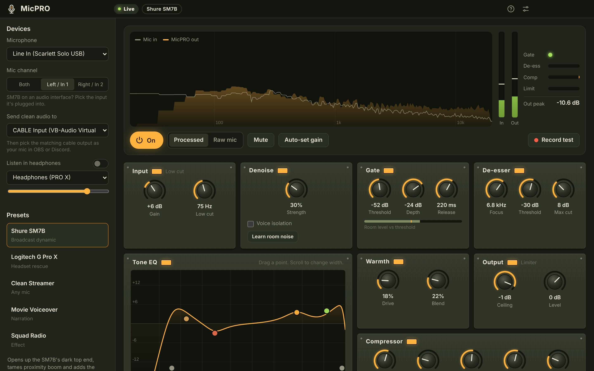

# MicPRO

[](https://buymeacoffee.com/g.hostproxy)

Real-time microphone enhancement for streamers and video creators. MicPRO sits between your mic and OBS / Discord / the game and runs your voice through a broadcast-style chain:

**Denoise → Gate → Tone EQ → De-esser → Warmth → Compressor → Limiter**



## Features

- **Spectral denoise** that tracks your room/PC noise automatically, plus a one-click "Learn room noise" profile and optional voice isolation.
- **Smooth noise gate** with hold and hysteresis, so words aren't chopped.
- **Draggable EQ curve** (low cut, body, mud, presence, air, high cut).
- **Split-band de-esser** that only turns down the sibilant band.
- **Warmth** (parallel tanh saturation), **compressor**, and a **limiter** that keeps peaks under the ceiling.
- **Presets** for the **Shure SM7B** and **Logitech G Pro X**, plus Clean Streamer and Movie Voiceover. Save, import and export your own.
- **Voice changer** with seven voices:
  - **Radio** (Walkie-Talkie, Tactical Comms, Field Radio): a real transmitter model with voice-activated key-up click, band-limited overdriven voice, static, crackle and breakups, roger beep and squelch tail.
  - **Girl** and **God**: a PSOLA pitch shifter with independent formant shifting. God adds a sub-octave layer and a large synthetic hall reverb.
  - **Blown Out** (ear-rape): bass-boosted hard clipping and crush, gated between words. The headphone monitor drops 12 dB while it's on.
  - Each voice has its own knobs, plus a hotkey to toggle it.
- **Auto-set gain**: talk for five seconds and MicPRO sets your input level.
- **Record test**: record raw and processed side by side, A/B them, save 24-bit WAVs for your edits.
- **Global hotkeys** for mute and bypass, tray mode, headphone monitoring.
- About 20 ms total latency, including headphone monitoring (a dedicated monitor engine plays straight to your headphones). Everything runs locally.
- Turns on when it opens, can open at sign-in, and remembers your mic and outputs. An unplugged device stays selected (greyed out) and MicPRO switches back when it returns.

## Using it

1. Install [VB-CABLE](https://vb-audio.com/Cable/) (free) so other apps can hear MicPRO.
2. In MicPRO, choose your mic, then set **Send clean audio to** → `CABLE Input`.
3. In OBS / Discord / Tarkov, choose `CABLE Output` as the microphone. Turn off their own noise suppression and auto gain.
4. Load a preset and press **Auto-set gain**.

**SM7B on an audio interface:** set **Mic channel** to the input the mic is plugged into (usually *Left / In 1*), and give the mic 55–60 dB of clean gain at the interface or with a Cloudlifter/FetHead.

**Logitech G Pro X:** turn Blue VO!CE off in G HUB so the voice isn't processed twice.

## Develop

```bash
cd app
npm install
npm start          # run the app
npm run dist:win   # build an installer into app/dist
```

## Releases

MicPRO is sold on the Microsoft Store (see `STORE.md`). To ship an update, bump `version` in `app/package.json`, run the **Build Microsoft Store package** workflow, and upload the new `.appx` in Partner Center. The **Build test installers** workflow builds unsigned test installers as run artifacts; it doesn't publish anything.

## Microsoft Store

`STORE.md` walks through publishing the Store version. The **Build Microsoft Store package** workflow builds the `.appx` from your Partner Center identity.

## Website

`index.html` (with `privacy.html` and `assets/`) is the product page. Set `STORE_URL` near the bottom of `index.html` once the Store listing is live. GitHub Pages can serve it from this repo only while the repo is public or on a paid GitHub plan; otherwise host those files from a separate public repo.

## Project layout

```
index.html                 download / marketing page
assets/                    page images
app/
  package.json             Electron + electron-builder config
  build/                   app icons
  src/main/                Electron main process + preload
  src/renderer/            UI (HTML/CSS/JS)
    audio-engine.js        Web Audio processing graph
    presets.js             factory presets
    voices.js              voice changer voices
    dsp/processors.js      AudioWorklet DSP: denoise, gate, de-esser, radio voice, recorder
```

Proprietary. All rights reserved (see `LICENSE`). Not affiliated with Shure, Logitech or Battlestate Games.

## Support MicPRO

If MicPRO made your mic sound better, you can support development here:

<a href="https://buymeacoffee.com/g.hostproxy"></a>
