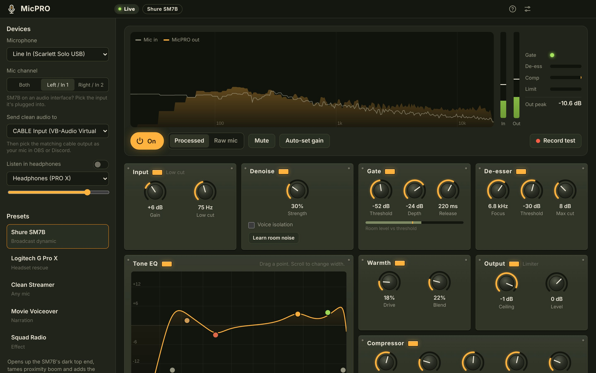

# MicPRO

Real-time microphone enhancement for streamers and video creators. MicPRO sits between your mic and OBS / Discord / the game and runs your voice through a broadcast-style chain:

**Denoise → Gate → Tone EQ → De-esser → Warmth → Compressor → Limiter**



## Features

- **Spectral denoise** that tracks your room/PC noise automatically, plus a one-click "Learn room noise" profile and optional voice isolation.
- **Smooth noise gate** with hold and hysteresis, so words aren't chopped.
- **Draggable EQ curve** (low cut, body, mud, presence, air, high cut).
- **Split-band de-esser** that only turns down the sibilant band.
- **Warmth** (parallel tanh saturation), **compressor**, and a **limiter** that keeps peaks under the ceiling.
- **Presets** for the **Shure SM7B** and **Logitech G Pro X**, plus Clean Streamer, Movie Voiceover and Squad Radio. Save, import and export your own.
- **Auto-set gain**: talk for five seconds and MicPRO sets your input level.
- **Record test**: record raw and processed side by side, A/B them, save 24-bit WAVs for your edits.
- **Global hotkeys** for mute and bypass, tray mode, headphone monitoring.
- About 20 ms total latency. Everything runs locally.

## Using it

1. Install [VB-CABLE](https://vb-audio.com/Cable/) (free) so other apps can hear MicPRO.
2. In MicPRO, choose your mic, then set **Send clean audio to** → `CABLE Input`.
3. In OBS / Discord / Tarkov, choose `CABLE Output` as the microphone. Turn off their own noise suppression and auto gain.
4. Load a preset and press **Auto-set gain**.

**SM7B on an audio interface:** set **Mic channel** to the input the mic is plugged into (usually *Left / In 1*), and give the mic 55–60 dB of clean gain at the interface or with a Cloudlifter/FetHead.

**Logitech G Pro X:** turn Blue VO!CE off in G HUB so the voice isn't processed twice.

## Develop

```bash
cd app
npm install
npm start          # run the app
npm run dist:win   # build an installer into app/dist
```

## Releases

Bump `version` in `app/package.json` and push to `main`. `.github/workflows/release.yml` builds Windows, macOS and Linux installers and publishes them as the matching `vX.Y.Z` GitHub release. You can also run it by hand from the Actions tab. The download buttons on the website point at `releases/latest`, so they update automatically.

## Website

`index.html` at the repo root is the download page. Serve it with GitHub Pages (Settings → Pages → Deploy from branch → `main` / root).

## Project layout

```
index.html                 download / marketing page
assets/                    page images
app/
  package.json             Electron + electron-builder config
  build/                   app icons
  src/main/                Electron main process + preload
  src/renderer/            UI (HTML/CSS/JS)
    audio-engine.js        Web Audio processing graph
    presets.js             factory presets
    dsp/processors.js      AudioWorklet DSP: denoise, gate, de-esser, recorder
```

MIT licensed. Not affiliated with Shure, Logitech or Battlestate Games.
